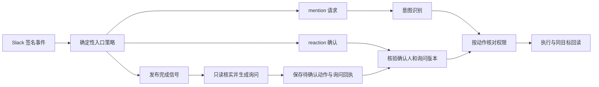

# Slack 触发与动作授权设计

状态：混合实现与设计说明。当前已实现 mention 准入、作者身份查询、取消、原生状态/停止按钮、启动表情清理及时间 wakeup 独立交付；reaction 确认触发、发布后关单和下面的动作授权记录尚未实现。

## 当前合同

入口验 Slack 签名和时间戳，再校验 Team、channel、sender 与 mention target。consumer 在 QStash 验签后按当前策略复核。`SLACK_ALLOWED_SENDER_IDS` 控制 mention 触发人，允许精确列表或 `all`；blocklist 优先。取消目前只允许 `SLACK_TARGET_USER_IDS` 中的真人发送者。作者查询以 `users.info.user.is_bot` 区分真人与 Bot。

`SLACK_REACTION_NAME` 是 Relay 接单后添加的状态表情，不是 reaction 触发器。`reactions:write` 允许添加/移除表情；接收 `reaction_added` 需要事件订阅和 `reactions:read`。Bot 与 User token 都支持 reaction 读取，事件可见范围依赖对应身份与会话访问权。

Agent 的意图 Skill 决定执行、回答、澄清或静默。它只在已有权限内解释请求；触发白名单、业务授权、工具凭据与实际副作用分别管理。

## 推荐模型

保留三个明确入口，复用 Slack Events → QStash → consumer → Multica，避免另开 listener。

| 入口 | 谁可以触发 | 固定目标与权限 |
| --- | --- | --- |
| mention | 配置的真人列表或 `all` | 查询、分析、草稿、原线程答复；外部写入按动作策略另核对 |
| reaction confirmation | 默认关闭；启用时只列明确确认人 | 已登记且未过期的询问消息，绑定具体动作、对象和版本 |
| deployment signal | 明确频道 + Bot/User ID + 精确事件类型/文案 | 只创建发布后检查/询问任务，权限不包含 Jira 状态写入 |

建议保持当前 mention 白名单，待读取范围与动作控制验证后再选择开放 `all`。用户明确决定开放时只修改 mention policy；reaction confirmations 和 cancellation 各自保持精确列表。

事件身份独立于消息位置：mention 使用源消息 ID，reaction 使用独立 triggerId 并保留被点消息的 subjectMessageTs 与 reaction eventTs；原 thread 是回复目的地。新的触发建立新的交付来源，重投同一触发复用回执。保持 v5 上下文里的实际消息文本和作者，确认人的身份放在可信 trigger 字段中，避免把 Bot 的询问伪装成真人消息或沿用旧事件而被回复 ledger 去重。

## Reaction 确认的最小记录

复用现有 Redis 与 Multica 的任务关联。待确认记录保存 `actionId`、policyVersion、workspace/project/issue、Slack team/channel/thread/askTs、询问作者、正文摘要、allowedConfirmers、emoji、明确 action、对象集合及其版本、expiresAt、状态和结果回执。确认范围由发送前冻结的记录决定，正文里的 marker 只用于定位。

- 入站只做廉价匹配：Team、频道、reaction 类型、确认人、emoji、message item。无匹配直接忽略；QStash 保存最小投影。
- consumer 按当前策略复核，查待确认记录，再回读被点的精确消息，校验作者、thread、正文摘要和有效期。修改后的询问、根帖上的同名 emoji、已过期记录和撤销策略拒绝执行。
- 确认只追加到原有 Issue；丢失映射时先查持久来源，无法唯一恢复时保留待核对，避免新建另一张卡或扩大对象范围。
- 去重使用 actionId + actionVersion；同一次 Slack event 重送、移除后重加 emoji、多人同时确认均只消费同一动作一次。不同确认人集合不产生多份执行权。
- 状态为 pending → executing → succeeded / failed / unknown。并发 claim 使用现有 store 的原子能力；部分成功按对象保存回执，重试只处理可证明未完成的项。写入结果 unknown 时先回读，避免重放。
- `reaction_removed` 不回滚已执行动作。需要取消时使用独立撤销操作，且只撤销尚未开始的动作。

## 发布后处理 Jira

参考 Luz 的 P1/P2：指定发布 Bot 在指定频道回复精确成功文案后，回读根帖，核对 production 标题与目标 owner mention；只读查询本人的相关工单，已完成项跳过，有候选才在同一 thread 询问。

询问列出每张工单及拟执行动作，保存固定候选与询问回执。本人在这条询问上确认后，重新核对工单类型、归属、当前状态及允许 transition。Online Bug 的验收与 QA 指派规则由当前 Jira workflow/团队合同确定；其它类型同样按实际 transition ID 执行。对象、类型或动作变化时重新询问；只因已完成而减少对象时可跳过并回报。发布失败只记录结果。

普通发布审批、GitHub Environment 审批与发布后 Jira 处理是不同动作。代码中的 confirmation 永远只授予登记的那一种动作。

## 策略与真正的执行边界

策略按主体、入口、频道、动作和对象约束匹配，不建设通用 IAM 平台。未命中的动作默认无授权；意图模型只能选择策略已允许的动作。owner 能确认高风险动作，其他触发人可获得只读分析和原线程回复。

Luz 的签名授权 envelope 可证明上下文由持钥者生成且未改写，但同一 Runtime 同时持有签名 key 与业务 token 时，它只提供协议约束。真正限制 Jira/GitHub 写入，需要把副作用收口到确定性执行器，执行器读取当前 policy 和 pending action，Agent 只提交 actionId；业务凭据留在执行器侧。当前 Runtime 的 shell 与个人凭据不具备这种隔离，开放 mention 之前须明确采用哪种信任范围。

第一版只实现明确需要的 Jira transition/assign；先使用当前 API 合同取得状态与回读结果。使用公钥验签可减少 Runtime 接触签名私钥，但它仍不能替代业务写入的执行门。

## OAuth scope 与上线核对

| 能力 | Slack 权限/配置 |
| --- | --- |
| 区分真人与 Bot | 所选作者查询 token 的 `users:read` |
| 读取线程与原消息 | 当前会话类型的 history scope 和会话可见性；频道线程读取沿现有 User context token |
| 接收 reaction | 对应安装身份订阅 `reaction_added`，并获 `reactions:read` |
| 清理启动表情 | 原添加身份的 `reactions:read` + `reactions:write` |
| 发送询问/回执 | 固定发送身份的 `chat:write` 与目标会话访问权 |

Scope 只限定应用 API 能力。谁能确认某项动作由应用策略决定；无需为每个确认人创建一套 Slack App。先核对当前安装清单与实际 token scope，再申请确有缺口的权限。权限变更、Agent 绑定、生产部署和启用工作流分别回读。

## 验收

必须覆盖：真人 User token 带 bot metadata、Bot 自触发、非 owner reaction、错误 emoji、根帖 reaction、伪造 marker、询问编辑、跨频道/跨任务重放、过期、排队期间策略收紧、重复事件、取消与执行竞争、Jira 部分成功、未知写入和回执失败。

本地验证完成后，在获授权测试线程核对 Slack 事件 → 队列 → 原任务 → 有效确认 → 单次动作 → 原线程结果；配置保存与 run completed 分别记录。值守与其它 Agent 配置保持独立。

## 参考

- [Luz 发布后询问 PR #5](https://github.com/Luz-Liu/slack-multica-relay/pull/5)
- [Luz reaction 确认 PR #6](https://github.com/Luz-Liu/slack-multica-relay/pull/6)
- [Slack reaction_added](https://docs.slack.dev/reference/events/reaction_added/)
- [Slack reactions:read](https://docs.slack.dev/reference/scopes/reactions.read/)
